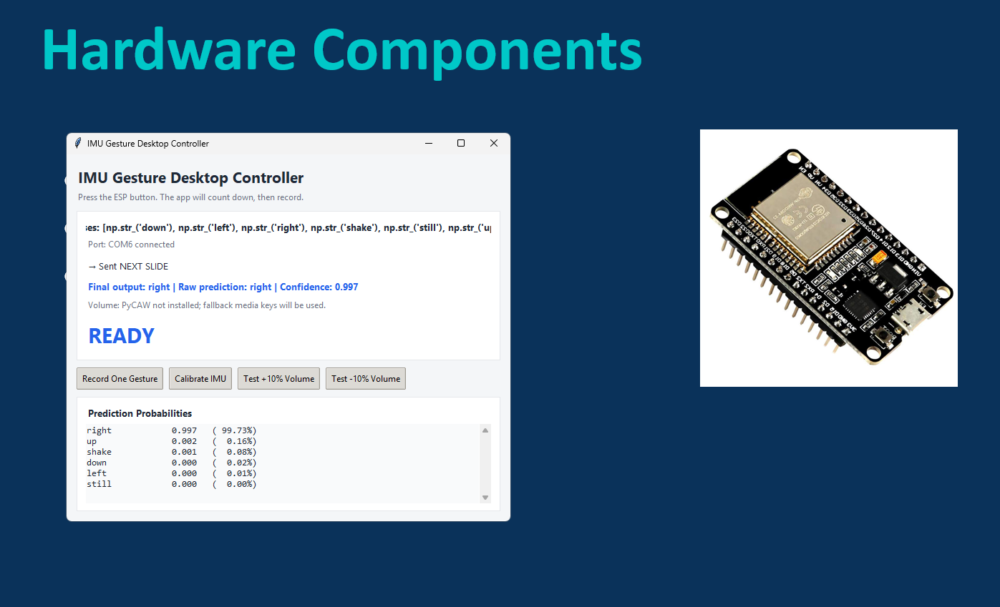

# AI-Powered IMU Gesture Controller for Desktop and Presentation Control

A real-time AI gesture recognition system built with an ESP32 microcontroller and an MPU6050 6-axis IMU sensor. The system recognizes six hand gestures from IMU time-series data and maps them to desktop or presentation commands such as previous slide, next slide, volume up, volume down, escape/cancel, and no action. The system runs locally over USB serial with no cloud dependency.

This project was built for the CAP4630 Final Project as a **Track 2 — Application** project. It extends an IMU gesture recognition pipeline into a working desktop control prototype using a trained neural network and a live Python application.

---

## Table of Contents

1. [What This Project Does](#what-this-project-does)
2. [Hardware](#hardware)
3. [Repository Structure](#repository-structure)
4. [How It All Works — End to End](#how-it-all-works--end-to-end)
5. [Step 1 — Firmware (ESP32)](#step-1--firmware-esp32)
6. [Step 2 — Data Collection (logger.py)](#step-2--data-collection-loggerpy)
7. [Step 3 — Model Training (Notebook)](#step-3--model-training-notebook)
8. [Step 4 — Live Demo Scripts](#step-4--live-demo-scripts)
9. [The Two Models: MLP vs CNN](#the-two-models-mlp-vs-cnn)
10. [Gestures](#gestures)
11. [Dataset](#dataset)
12. [Trained Model Files](#trained-model-files)
13. [Setup & Installation](#setup--installation)
14. [Running the Project](#running-the-project)
15. [Design Decisions](#design-decisions)

---

## What This Project Does

You hold an ESP32 board with an MPU6050 IMU sensor in your hand. The MPU6050 measures accelerometer and gyroscope motion data around 50 times per second. When the user triggers a gesture capture, the system records a fixed 1-second window of IMU data, sends it to a trained machine learning model, classifies the gesture, and maps the prediction to a desktop or presentation command.

The goal is to turn raw hand motion into useful computer actions without needing a keyboard, touchpad, or handheld clicker.

## Final Demo Video

[](assets/final_demo.mp4)

Click the image above to watch the final demo.
Short demo showing the IMU gesture recognition system controlling presentation slides.

**The full pipeline:**

```text
User hand motion
      ↓
ESP32 + MPU6050 + physical button
      ↓  USB serial at 115200 baud
Python desktop application
      ↓  collects 51 samples, about 1 second
Preprocessing and normalization
      ↓
Trained ML model, CNN or MLP
      ↓  classifies gesture
Confidence filter
      ↓
Keyboard / desktop output
      ↓
Controls slides, volume, escape/cancel, or no action
```

---

## Hardware

| Component | Detail |
|-----------|--------|
| Microcontroller | ESP32 |
| IMU Sensor | MPU6050, 6-axis accelerometer + gyroscope |
| I2C Connection | SDA on GPIO 21, SCL on GPIO 22 |
| Physical Button | Used to trigger one controlled gesture capture window |
| PC Connection | USB serial at 115200 baud |

**What the MPU6050 measures:**

- **Accelerometer (`ax_g`, `ay_g`, `az_g`):** Measures acceleration in g-forces. This helps detect device orientation and tilt.
- **Gyroscope (`gx_dps`, `gy_dps`, `gz_dps`):** Measures rotational speed in degrees per second. This helps detect shaking and fast motion.

**Sensor scaling applied in firmware:**
- Raw accelerometer ÷ 16384 → g-forces (±2g range)
- Raw gyroscope ÷ 131 → degrees/second (±250 dps range)

---

## Repository Structure

```
imu_ges_remote/
├── data/
│   ├── raw_new/                        # Current training dataset (6 gesture CSVs)
│   │   ├── shake.csv
│   │   ├── still.csv
│   │   ├── tilt_left.csv
│   │   ├── tilt_right.csv
│   │   ├── tilt_up.csv
│   │   └── tilt_down.csv
│   └── raw_old/                        # Previous dataset (earlier collection session)
├── firmware/
│   └── imu_remote.ino                  # Arduino firmware — flash this to the ESP32
├── hardware/                           # Hardware schematics / wiring diagrams
├── models/
│   ├── imu_gesture_cnn.keras           # Trained CNN model (652 KB)
│   ├── imu_gesture_mlp.pkl             # Trained MLP model (759 KB)
│   ├── label_classes.npy               # Gesture class labels
│   ├── feature_mean.npy                # Normalization mean (from training data)
│   ├── feature_std.npy                 # Normalization std (from training data)
│   └── old model/                      # Previous model version (CNN from April 10)
│       ├── imu_gesture_cnn.keras
│       └── label_classes.npy
├── notebooks/
│   └── imu_gesture_training.ipynb      # Training notebook (MLP + 1D CNN)
├── report/
│   └── CAP4630 - Assignment 2 - Jordan Wray  # Course report
├── src/
│   ├── live_demo.py                    # Basic live demo (press Enter to classify)
│   ├── live_demo_hotkey_ad.py          # Advanced demo with global hotkeys + GUI
│   ├── V2_live_demo.py                 # Modular demo for testing (no keyboard output)
│   └── logger.py                       # Data collection script
└── .gitignore
```

---

## How It All Works — End to End

### The Big Picture

There are 4 major stages. Each stage feeds the next:

```text
Stage 1: Flash firmware to ESP32
              ↓
Stage 2: Collect labeled gesture data with logger.py
              ↓
Stage 3: Train ML models in the notebook and export model artifacts
              ↓
Stage 4: Run live demo script for real-time classification and desktop control
```

### What is a window?

The IMU streams data at about 50 Hz, which means around 50 samples per second. For each gesture, the system captures exactly **51 consecutive samples**. This 51-sample block is called a **window**.

Every model prediction is made from one window.

Each input window has shape:

```text
51 timesteps × 6 sensor axes = 306 values total
```

The six axes are:

```text
ax_g, ay_g, az_g, gx_dps, gy_dps, gz_dps
```

---

## Step 1 — Firmware ESP32

**File:** `firmware/imu_remote.ino`

This is the Arduino code that runs directly on the ESP32 hardware.

**What it does:**

- Initializes the MPU6050 sensor over I2C
- Reads accelerometer and gyroscope values
- Applies sensor scaling and optional calibration offsets
- Listens for commands over USB serial
- Supports controlled gesture capture using a physical button
- Streams IMU readings at about 50 Hz in CSV format

**Serial commands sent from PC to ESP32:**

| Command | Effect |
|---------|--------|
| `start` | Begin streaming sensor data |
| `stop` | Stop streaming sensor data |
| `calibrate` | Run calibration routine while the IMU is flat and still |

**Calibration:**

The device should be held flat and still during calibration. The firmware averages several IMU readings to estimate sensor bias and subtracts that bias from future readings. This reduces drift and improves consistency between data collection and live inference.

**Output format per line:**

```csv
timestamp_ms,ax_g,ay_g,az_g,gx_dps,gy_dps,gz_dps
24,-0.444,-0.061,0.827,-18.71,-24.16,95.43
```

Field meanings:

- `timestamp_ms` — milliseconds since the current streaming session started
- `ax_g`, `ay_g`, `az_g` — accelerometer values in g-force units
- `gx_dps`, `gy_dps`, `gz_dps` — gyroscope values in degrees per second

---

## Step 2 — Data Collection logger.py

**File:** `src/logger.py`

This Python script runs on the PC and builds the labeled training dataset.

**Workflow:**

1. Run the logger script.
2. Enter an output CSV filename and session ID.
3. Connect to the ESP32 over USB serial, `COM6` by default.
4. Optionally run IMU calibration.
5. Enter the gesture label, such as `tilt_left` or `shake`.
6. The script counts down so the user can prepare.
7. The system records exactly **51 samples** from the ESP32.
8. The 51 samples are saved as one labeled trial.
9. Repeat for each gesture class.

**Output CSV format:**

```csv
session_id,gesture,trial_id,timestamp_ms,ax_g,ay_g,az_g,gx_dps,gy_dps,gz_dps
session_1,shake,1,2,-0.444,-0.061,0.827,-18.71,-24.16,95.43
session_1,shake,1,24,-0.448,-0.059,0.831,-19.02,-24.05,96.12
```

**Key design points:**

- Each trial is exactly 51 rows.
- The logger saves `session_id`, `gesture`, and `trial_id`.
- The fixed row count keeps training and live inference consistent.
- Gesture data is saved into CSV files in `data/raw_new/`.

---

## Step 3 — Model Training Notebook

**File:** `notebooks/imu_gesture_training.ipynb`

This notebook loads the collected CSV data, preprocesses it, trains two models, evaluates them, and exports the trained files used by the live demo.

### Data Preprocessing

1. **Load** all gesture CSV files.
2. **Combine** the gesture data into one dataset.
3. **Normalize label names** so variants like `tilt_left` can map to `left` if needed.
4. **Group rows into windows** so each trial becomes one sample of shape `(51, 6)`.
5. **Pad or check sequences** so each window is exactly 51 timesteps.
6. **Encode labels** using `LabelEncoder`.
7. **Split data** into train, validation, and test sets using a stratified split.
8. **Normalize features** using Z-score normalization computed from the training set only.

```text
X_normalized = (X - mean) / std
```

The notebook saves `feature_mean.npy` and `feature_std.npy` so the exact same normalization is applied during live inference.

### Label Naming Note

The raw dataset uses descriptive labels such as:

```text
tilt_left, tilt_right, tilt_up, tilt_down, shake, still
```

During preprocessing, these may be normalized into shorter model labels:

```text
left, right, up, down, shake, still
```

The live demo accepts both naming styles where needed. This is why the saved class order may show `left` instead of `tilt_left`.

### MLP Model Baseline

A **Multi-Layer Perceptron** is used as the baseline model.

**Architecture:**

```text
Input: 306 values, from 51 timesteps × 6 axes flattened into 1D
→ Dense layer: 128 neurons, ReLU
→ Dense layer: 64 neurons, ReLU
→ Output layer: 6 neurons, Softmax
```

The MLP is useful because it gives a simple baseline. However, flattening the input removes the time structure of the motion signal.

### 1D CNN Model Main Model

A **1D Convolutional Neural Network** is used as the main model because the input is time-series IMU data.

**Architecture:**

```text
Input: 51 timesteps × 6 axes
→ Conv1D: 32 filters, kernel size 3, ReLU
→ MaxPooling1D: pool size 2
→ Conv1D: 64 filters, kernel size 3, ReLU
→ MaxPooling1D: pool size 2
→ Flatten
→ Dense: 64 neurons, ReLU
→ Dropout: 30%
→ Output: 6 neurons, Softmax
```

The CNN keeps the time dimension intact, allowing the model to learn short motion patterns such as a shake spike or a sustained tilt.

### Exports

After training, the notebook saves:

| File | Purpose |
|------|---------|
| `imu_gesture_cnn.keras` | Saved TensorFlow/Keras CNN model |
| `imu_gesture_mlp.pkl` | Saved scikit-learn MLP model |
| `label_classes.npy` | Saved gesture class order |
| `feature_mean.npy` | Training-set mean used for normalization |
| `feature_std.npy` | Training-set standard deviation used for normalization |

---

## Step 4 — Live Demo Scripts

All live demo scripts in `src/` follow the same prediction pipeline:

```text
Capture 51 samples from ESP32 serial
        ↓
Normalize with feature_mean.npy and feature_std.npy
        ↓
Reshape for selected model
        ↓
Model outputs probability for each gesture class
        ↓
Apply confidence threshold
        ↓
Return gesture or unknown
        ↓
Execute mapped desktop command if valid
```

### live_demo.py — Basic Demo

This is the simplest live demo version. The user triggers one prediction from the terminal.

Controls:

| Input | Action |
|-------|--------|
| Enter | Record and classify one gesture |
| `c` | Recalibrate IMU |
| `a` | Toggle desktop actions on/off |
| `q` | Quit |

### live_demo_hotkey_ad.py — Advanced Demo Recommended

This is the recommended final demo script. It is designed for live presentation use.

Features:

- Global hotkey trigger
- Optional model selection between CNN and MLP
- Always-on-top Tkinter status window
- Confidence score display
- Probability breakdown for all gesture classes
- Desktop command execution
- Cooldown to avoid repeated accidental actions

Global hotkeys:

| Hotkey | Action |
|--------|--------|
| Backtick, `` ` `` | Record and classify one gesture |
| Ctrl+Shift+C | Recalibrate IMU |
| Ctrl+Shift+Q | Quit |

> Windows note: the `keyboard` package may require Administrator privileges to register global hotkeys.

### V2_live_demo.py — Testing / Development

This version is useful for debugging because it runs the same prediction logic without sending keyboard output. It helps test model accuracy without accidentally controlling the desktop.

---

## The Two Models: MLP vs CNN

### MLP Multi-Layer Perceptron

The MLP takes the full 51×6 IMU window and flattens it into a 306-value vector. It then passes the values through dense layers to predict the gesture.

**Best for:**

- Simple baseline comparison
- Fast inference
- Showing that the IMU features are useful even with a basic model

**Weakness:**

The MLP does not naturally preserve the time order of the gesture signal.

### 1D CNN Convolutional Neural Network

The CNN keeps the 51-timestep sequence structure. Its convolutional filters slide across time and learn local motion patterns.

**Best for:**

- Time-series gesture recognition
- Learning motion patterns across short windows
- Main deployed model in the live demo

**Why it is better for this project:**

The gesture data is not just a list of numbers. It is motion over time. The CNN is better aligned with that structure.

---

## Gestures

| Gesture | Description | Typical IMU Signature |
|---------|-------------|-----------------------|
| `still` | Hold device flat and motionless | Low movement across all axes |
| `shake` | Rapid back-and-forth motion | High-frequency spikes in gyroscope axes |
| `tilt_left` | Tilt device left | Sustained orientation change |
| `tilt_right` | Tilt device right | Sustained orientation change in opposite direction |
| `tilt_up` | Tilt device upward | Sustained pitch/orientation change |
| `tilt_down` | Tilt device downward | Sustained pitch/orientation change in opposite direction |

---

## Final Gesture-to-Command Mapping

| Gesture Label | Desktop / Presentation Action |
|---------------|-------------------------------|
| `tilt_left` or `left` | Previous slide |
| `tilt_right` or `right` | Next slide |
| `tilt_up` or `up` | Volume up |
| `tilt_down` or `down` | Volume down |
| `shake` | Escape / cancel |
| `still` | No action |
| `unknown` | No action |

The confidence filter prevents low-confidence predictions from sending commands. If the model is not confident enough, the final output becomes `unknown` and no desktop action is executed.

---

## Dataset

| File | Gesture | Trials | Samples per Trial | Total Rows |
|------|---------|--------|-------------------|------------|
| `still.csv` | still | 20 | 51 | 1,020 |
| `shake.csv` | shake | 20 | 51 | 1,020 |
| `tilt_left.csv` | tilt_left | 20 | 51 | 1,020 |
| `tilt_right.csv` | tilt_right | 20 | 51 | 1,020 |
| `tilt_up.csv` | tilt_up | 20 | 51 | 1,020 |
| `tilt_down.csv` | tilt_down | 20 | 51 | 1,020 |
| **Total** | 6 classes | **120** | 51 | **6,120** |

The dataset is small but useful because the gestures are physically distinct and were collected in a controlled setup. Each example is a fixed-length IMU window with six sensor features per timestep.

Important dataset facts:

- The dataset was self-collected using the ESP32 + MPU6050 system.
- Each trial has the same length: 51 samples.
- Each row contains accelerometer and gyroscope data.
- Each trial is labeled with one gesture class.

---

## Trained Model Files

All model artifacts are stored in `models/`.

| File | Description |
|------|-------------|
| `imu_gesture_cnn.keras` | TensorFlow/Keras 1D CNN model |
| `imu_gesture_mlp.pkl` | scikit-learn MLP model saved with joblib |
| `label_classes.npy` | Class order used during inference |
| `feature_mean.npy` | Feature mean computed from training data |
| `feature_std.npy` | Feature standard deviation computed from training data |

The normalization files are critical. The live demo must apply the same normalization used during training or the model may receive data on the wrong scale.

If the model is retrained, these files should be exported again:

```text
imu_gesture_cnn.keras
imu_gesture_mlp.pkl
label_classes.npy
feature_mean.npy
feature_std.npy
```

---

## Experiments and Results

### Experiment 1 — MLP Baseline vs 1D CNN

This experiment compared a flattened MLP baseline against a 1D CNN trained on the same 51-sample IMU gesture windows.

| Model | Full Dataset Test Accuracy | 50% Training Data Accuracy |
|-------|----------------------------|-----------------------------|
| MLP | 100% | 91.67% |
| 1D CNN | 100% | 100% |

Both models performed well on the full dataset, showing that the IMU data contains enough signal to separate the gesture classes. The CNN was selected as the main deployed model because it preserves the time-series structure of the signal and performed better when less training data was available.

### Experiment 2 — Fixed Window Gesture Capture

This experiment tested whether using a fixed 51-sample gesture window improved consistency between training and live inference.

Result:

- Every training trial and live prediction uses the same input shape: `(51, 6)`.
- This avoids variable-length input problems.
- It makes the live demo easier to control and explain.
- It supports the rule: one trigger equals one gesture window and one prediction.

### Experiment 3 — Live Gesture-to-Command Mapping

This experiment tested whether the trained model could be used in a real desktop control application.

The live demo loads the trained model, captures one IMU window, applies the saved normalization, predicts the gesture, filters low-confidence predictions, and sends a mapped desktop command.

Final command behavior:

| Prediction | Action |
|------------|--------|
| `left` / `tilt_left` | Previous slide |
| `right` / `tilt_right` | Next slide |
| `up` / `tilt_up` | Volume up |
| `down` / `tilt_down` | Volume down |
| `shake` | Escape / cancel |
| `still` / `unknown` | No action |

This confirms that the system is not only a classifier. It is a working AI-powered desktop controller prototype.

---

## Setup and Installation

### 1. Clone the repository and create a virtual environment

```bash
cd imu-gesture-smart-remote
python -m venv .venv
.venv/Scripts/activate
```

### 2. Install dependencies

```bash
pip install numpy pandas matplotlib seaborn scikit-learn tensorflow pyserial keyboard pyautogui joblib
```

### 3. Flash firmware to ESP32

1. Open `firmware/imu_remote.ino` in the Arduino IDE.
2. Select the correct ESP32 board.
3. Select the correct COM port.
4. Upload the firmware.
5. Open Serial Monitor at 115200 baud to verify that the ESP32 is running.

---

## Running the Project

### Collect new gesture data

```bash
python src/logger.py
```

### Train or retrain the models

Open the notebook below in Jupyter, VS Code, or Google Colab:

```text
notebooks/imu_gesture_training.ipynb
```

Run all cells to train the MLP and CNN models and export the model files.

### Run the basic live demo

```bash
python src/live_demo.py
```

### Run the advanced final demo

```bash
# Run as Administrator on Windows if global hotkeys do not respond
python src/live_demo_hotkey_ad.py
```

---

## Design Decisions

**Why 51 samples?**

Gestures last roughly 1 second. At about 50 Hz, that is about 50 samples. Using 51 samples gives a consistent fixed window for both training and live inference.

**Why fixed windows instead of variable-length gestures?**

Neural networks need consistent input shapes. Fixed windows make every trial and prediction the same shape: `(51, 6)`.

**Why Z-score normalization?**

Accelerometer and gyroscope values are on different scales. Normalization prevents the larger gyroscope values from dominating the model.

**Why save mean and standard deviation separately?**

The live demo must apply the same transformation used during training. Saving `feature_mean.npy` and `feature_std.npy` makes inference consistent and reproducible.

**Why use a physical button?**

The button creates a controlled start point for gesture capture. It is cleaner than always-listening motion detection because the model only predicts when the user intentionally triggers a gesture.

**Why use confidence thresholds?**

The model may occasionally output a low-confidence prediction. A confidence threshold lets the system reject uncertain predictions as `unknown` instead of sending the wrong desktop command.

**Why use a lower threshold for shake?**

Shake gestures are more dynamic and variable than tilt gestures. A slightly lower threshold prevents valid shake gestures from being rejected too often.

**Why keep both CNN and MLP?**

The MLP provides a baseline. The CNN is the main deployed model. Comparing both models demonstrates why architecture choice matters for IMU time-series classification.

**Why keep inference on the PC?**

PC inference is simpler, more flexible, and easier to debug for this project. It also allows the ESP32 to focus on reliable sensor capture while Python handles machine learning and desktop commands.

---

## Limitations and Future Work

- The dataset was collected by one user under controlled conditions, so more users and more sessions would improve generalization.
- The current system runs inference on the PC, not directly on the ESP32.
- USB serial is reliable for the prototype, but Bluetooth or BLE would make the controller more practical.
- The model may need more data if the sensor orientation, grip, or user changes significantly.
- Future versions could add mode switching, more desktop commands, BLE communication, and lightweight on-device inference.

---

## Report

The final project report is included in the `report/` folder.

```text
report/CAP4630 - Final Project - Jordan Wray.pdf
```

The report explains the problem, proposed AI-based solution, system architecture, experiments, results, and lessons learned from building the prototype.